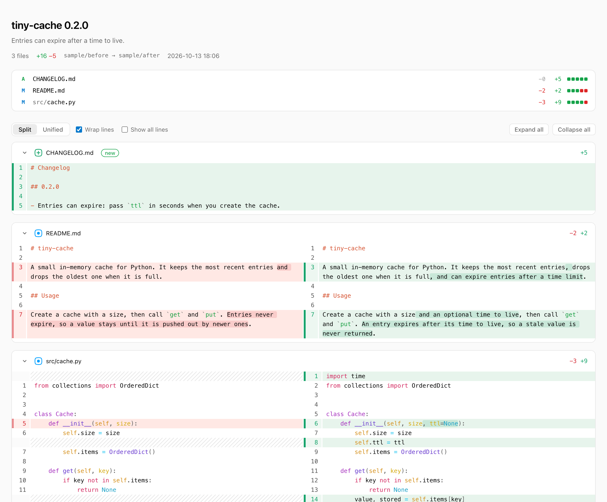
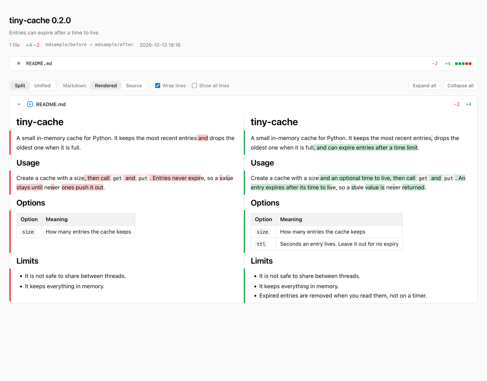

# diff-view

> Review an agent's edits the way you read them best: whole, side by side, in a browser.

diff-view is a Claude Code skill. After the agent edits files you will review, it renders the changes as one HTML page and opens it in your browser.

<picture>
  <source media="(prefers-color-scheme: dark)" srcset="docs/screenshot-dark.png">
  
</picture>

Markdown files are drawn as documents, aligned block by block:

<picture>
  <source media="(prefers-color-scheme: dark)" srcset="docs/screenshot-markdown-dark.png">
  
</picture>

## What the page shows

- **A file list** with each file's status, the lines removed and added, and a change bar.
- **Each file side by side**: the old text on the left and the new text on the right, or both in one column.
- **Markdown drawn as documents**: headings, lists and tables side by side, aligned block by block, with the changed words marked. A switch shows the same files as line diffs.
- **Changed words marked** inside each changed line, with the code syntax-highlighted.
- **Wrapped long lines**, so prose docs read without sideways scrolling.
- **Folded context**: unchanged stretches fold to a bar that expands on click.
- **Pinned file headers**, and files you can collapse one at a time or all at once.
- **Your system's theme**, light or dark.

## Install

### As a plugin

```sh
claude plugin marketplace add jinhuang712/diff-view
claude plugin install diff-view@diff-view
```

### As a personal skill

```sh
git clone https://github.com/jinhuang712/diff-view.git ~/dev/skills/diff-view
ln -s ~/dev/skills/diff-view/skills/diff-view ~/.claude/skills/diff-view
```

Start a new Claude Code session after you install it. The agent then uses the skill on its own after edits you will review. You can also ask for it, for example "show me the diff".

## Run it yourself

The script needs Python 3 and nothing else.

| Situation | Command |
|---|---|
| Changes in a git repo, against the last commit | `python3 skills/diff-view/scripts/diff_view.py --git --repo <repo> --open` |
| Against an older ref, such as a tag | `python3 skills/diff-view/scripts/diff_view.py --git --repo <repo> --base v0.1.0 --open` |
| Proposed edits kept in copies | `python3 skills/diff-view/scripts/diff_view.py --pair <original> <copy> --open` |
| Two folders | `python3 skills/diff-view/scripts/diff_view.py --dirs <before> <after> --open` |

[SKILL.md](skills/diff-view/SKILL.md) lists the other options: `--title`, `--subtitle`, `--context`, `--full` and `-o`.

## Known limits

- The page loads its renderers from esm.sh when you open it, so it needs a network connection. Without one, it shows a plain unified diff.
- A drawn Markdown document is compared block by block. A change inside a long list or table shows as one tall row, and images with relative paths do not load.
- Binary files are listed but not shown.
- It has been tested in Chrome only.

## License

[MIT](LICENSE). The page loads [@pierre/diffs](https://diffs.com) (Apache-2.0), [markdown-it](https://github.com/markdown-it/markdown-it) (MIT) and [visual-dom-diff](https://github.com/Teamwork/visual-dom-diff) (MIT).
